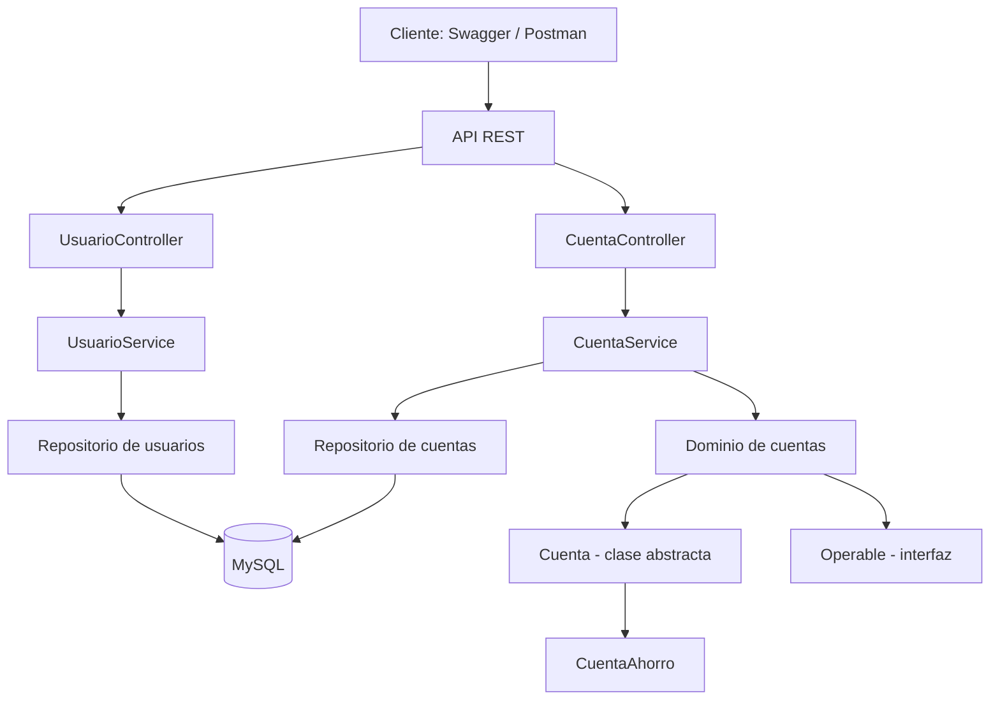

# API FinTech — Trabajo Práctico UTN

API REST académica para gestionar usuarios titulares y cuentas bancarias, desarrollada con **Java 21**, **Spring Boot 3.5.6**, **Maven**, **Spring Data JPA** y **MySQL 8**.

Proyecto de la **Diplomatura en Desarrollo de Software FinTech: IA y Microservicios — UTN**.

> **Alcance:** simulador académico de operaciones bancarias. No está destinado a operar con dinero real.

## Tecnologías

- Java 21 y Spring Boot 3.5.6
- Maven
- Spring Web y Spring Data JPA / Hibernate
- MySQL 8
- Jakarta Bean Validation
- Swagger / OpenAPI
- JUnit 5 y Mockito

## Arquitectura

El código se organiza por funcionalidades (`cuenta` y `usuario`), cada una con capas `domain`, `application`, `infrastructure` y `api`. El paquete `shared/exception` centraliza el manejo de errores.

- `Cuenta` es una clase abstracta y `CuentaAhorro` hereda de ella.
- `Operable` es una interfaz que representa operaciones sobre cuentas.
- La relación entre `Usuario` y `Cuenta` es **1:N**: un usuario puede ser titular de varias cuentas.
- Se utilizan DTOs `record` para evitar exponer directamente las entidades JPA.
- Los importes monetarios se representan con `BigDecimal` para evitar errores de precisión asociados a los tipos de punto flotante.

### Diagrama de arquitectura



## Requisitos previos

- JDK **21** instalado y configurado.
- Maven disponible (o Maven integrado en IntelliJ IDEA).
- MySQL **8** en ejecución.
- Un IDE como IntelliJ IDEA (opcional).

## Configuración y ejecución

1. Clonar el repositorio:

   ```bash
   git clone https://github.com/pviaut25/fintech-api-utn.git
   cd fintech-api-utn
   ```

2. Crear en MySQL la base de datos indicada por `spring.datasource.url` en `src/main/resources/application.properties` (o el archivo de configuración correspondiente). Verificar el nombre exacto allí antes de crearla.
3. Configurar las variables de entorno **`DB_USER`** y **`DB_PASSWORD`** con las credenciales locales de MySQL. No subir credenciales reales al repositorio.
4. Revisar la configuración de conexión a MySQL en `src/main/resources` y confirmar que coincida con el entorno local.
5. Ejecutar desde IntelliJ la clase principal `FintechApplication` o utilizar Maven desde la raíz del proyecto:

   ```bash
   mvn spring-boot:run
   ```

6. Con la aplicación iniciada, acceder a Swagger UI:

   **http://localhost:8080/swagger-ui/index.html**

> Si se ejecuta desde IntelliJ, configurar `DB_USER` y `DB_PASSWORD` en **Run → Edit Configurations → Environment variables** para la configuración de ejecución de la aplicación.

## Endpoints REST

| Método | Ruta | Respuestas principales |
| --- | --- | --- |
| POST | `/usuarios` | 201 |
| GET | `/usuarios/{id}` | 200 / 404 |
| GET | `/cuentas` | 200 |
| POST | `/cuentas` | 201 |
| GET | `/cuentas/{id}` | 200 / 404 |
| PUT | `/cuentas/{id}` | 200 / 404 |
| DELETE | `/cuentas/{id}` | 204 / 404 / 409 |
| POST | `/cuentas/{id}/depositos` | 200 |
| POST | `/cuentas/{id}/extracciones` | 200 / 409 |

Los códigos listados representan las respuestas principales; la documentación Swagger también describe errores de validación y otros conflictos aplicables.

### Ejemplos de uso

**Crear un usuario** — `POST /usuarios`:

```json
{
  "nombre": "Ana García",
  "email": "ana@example.com"
}
```

**Crear una cuenta** — `POST /cuentas`:

```json
{
  "numero": "CTA-000001",
  "alias": "mi.cuenta",
  "moneda": "ARS",
  "usuarioId": 1
}
```

El valor de `usuarioId` debe corresponder a un usuario previamente creado. Si ya existe una cuenta con el mismo número, usar uno diferente.

## Documentación Swagger / OpenAPI

La interfaz Swagger UI está disponible en:

**http://localhost:8080/swagger-ui/index.html**

Permite consultar los endpoints, inspeccionar los DTOs y ejecutar solicitudes HTTP. Las respuestas exitosas están documentadas con sus códigos correspondientes (`200`, `201` y `204`), y las respuestas de error (`400`, `404`, `409` y `500`, según corresponda) utilizan el esquema **`ProblemDetail`**.

## Colección de Postman

La colección de solicitudes HTTP se encuentra en:

`postman/Fintech-API.postman_collection.json`

Para utilizarla:

1. Abrir Postman y seleccionar **Import**.
2. Importar `postman/Fintech-API.postman_collection.json`.
3. Verificar que la variable `baseUrl` tenga el valor `http://localhost:8080`.
4. Ejecutar primero `POST /usuarios` y luego `POST /cuentas` con el ID del usuario creado.
5. Probar consultas, actualización de alias, depósitos, extracciones y cierre de cuenta.

## Pruebas automatizadas

El proyecto incorpora pruebas unitarias con **JUnit 5 y Mockito**:

- `CuentaAhorroTest`: comprueba reglas de negocio del modelo de cuentas.
- `CuentaServiceTest`: comprueba el comportamiento de la capa de servicios.

Para ejecutar las pruebas desde la raíz del proyecto:

```bash
mvn clean test
```

Para generar el paquete:

```bash
mvn package
```

En IntelliJ IDEA también pueden ejecutarse desde **Maven → Lifecycle → test**.

### Resultado verificado

Última ejecución informada: **17/10/2026, 18:04 (Argentina)**.

- **15** tests ejecutados.
- **0** fallos.
- **0** errores.
- **0** tests omitidos.
- Resultado: **BUILD SUCCESS**.

Este resultado confirma el éxito de las pruebas implementadas; no representa una medición de cobertura porcentual.

## Casos de prueba funcionales

1. Crear un titular con `POST /usuarios` y una cuenta asociada con `POST /cuentas`.
2. Consultar cuentas mediante `GET /cuentas` y `GET /cuentas/{id}`.
3. Actualizar el alias con `PUT /cuentas/{id}` sin modificar el saldo (**bonus**).
4. Cerrar una cuenta sin saldo mediante `DELETE /cuentas/{id}` y obtener **204 No Content** (**bonus**).
5. Consultar nuevamente la cuenta cerrada: permanece registrada con `activa: false`.
6. Consultar un ID inexistente y comprobar **404 Not Found**.
7. Depositar fondos e intentar cerrar una cuenta con saldo: la operación debe rechazarse con **409 Conflict**.
8. Revisar las pruebas JUnit/Mockito y la documentación Swagger.

## Decisiones de diseño

- **PUT:** modifica únicamente el alias. El saldo se actualiza mediante operaciones específicas de depósito y extracción.
- **DELETE:** implementa un **cierre lógico**, conserva el registro en MySQL y rechaza cuentas con saldo pendiente.
- **Número de cuenta:** se protege mediante una restricción `UNIQUE` y una comprobación previa; los conflictos concurrentes se gestionan mediante errores de integridad.
- **Transacciones:** se delimitan en la capa `application` mediante `@Transactional`.
- **Concurrencia:** `@Version` permite el control optimista.
- **Errores HTTP:** se utiliza `ProblemDetail` para documentar respuestas como `400` (entrada inválida), `404` (recurso inexistente), `409` (conflicto) y `500` (error inesperado).
- **Validaciones:** se aplican validaciones Jakarta y reglas de dominio.

## Persistencia y consideraciones de producción

La configuración `spring.jpa.hibernate.ddl-auto=update` está destinada **únicamente al desarrollo**. Para producción se requieren migraciones de base de datos versionadas, por ejemplo con Flyway.

Este proyecto es un **simulador académico**, no una plataforma apta para operar con dinero real. No incorpora autenticación/autorización, libro mayor contable de doble entrada (*ledger*), conciliación, idempotencia de operaciones, auditoría inmutable ni migraciones versionadas. Estos componentes serían necesarios para una solución FinTech productiva.

## Contenido del repositorio

- Código fuente completo: `pom.xml`, `src/main/java` y `src/main/resources`.
- Instrucciones de configuración y ejecución en este `README.md`.
- Colección de Postman: `postman/Fintech-API.postman_collection.json`.
- Tests automatizados en `src/test/java`.
- Archivo `.gitignore` para excluir secretos, archivos locales y resultados de compilación como `target/`.

## Repositorio

**https://github.com/pviaut25/fintech-api-utn**
